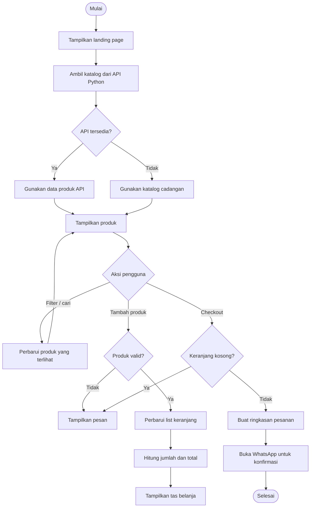

# Flowchart logika website reseller

## Algoritma checkout

1. Mulai.
2. Periksa apakah list keranjang memiliki item.
3. Jika kosong, tampilkan pesan dan hentikan proses.
4. Jika ada item, lakukan looping untuk membentuk ringkasan setiap produk.
5. Hitung total = jumlah harga tiap produk dikali kuantitasnya.
6. Susun pesan pesanan dan buka WhatsApp.
7. Selesai.
